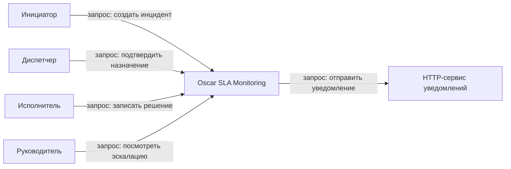
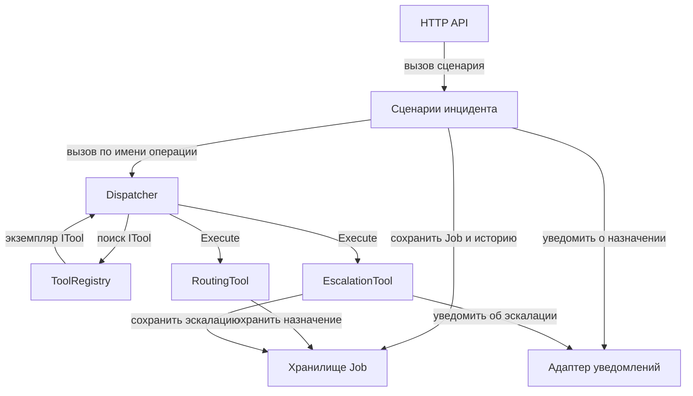

# Архитектура Oscar SLA Monitoring

Сервис регистрирует IT-инцидент, назначает исполнителя, считает сроки SLA и эскалирует просрочку. Инцидент — это Job. Стек заявки: ASP.NET Core, PostgreSQL, Entity Framework Core.

Диаграмма состояний и запрещённые переходы: [job-states.md](job-states.md).

## Контекст

Уровень Context в C4: система целиком, её пользователи и внешний сервис.

Стрелки на этой схеме — запросы между людьми, нашей системой и внешним сервисом. Это не зависимости исходного кода и не переходы состояний Job.

В систему входит регистрация инцидента, назначение, жизненный цикл, расчёт SLA, эскалация, история и вызов уведомлений. Пользовательский интерфейс, CMDB, календарь обслуживания и самостоятельные решения LLM в систему не входят.

## Компоненты

Что внутри одного процесса и кто кого вызывает.

Стрелки на этой схеме — вызовы во время обработки запроса. Направление стрелки — кто вызывает кого. Это не стрелки «проект ссылается на сборку» и не поток данных на диаграмме контекста.

Уведомление уходит один раз. После успешного `RoutingTool` адаптер вызывает сценарий инцидента. После сохранения эскалации адаптер вызывает `EscalationTool`. `RoutingTool` сам по сети не ходит.

| Компонент | За что отвечает и что скрывает от соседей |
|---|---|
| HTTP API | Принимает REST-запрос, проверяет форму JSON и заголовок `Idempotency-Key`, переводит `ToolResult` в HTTP-код. Скрывает от клиента Dispatcher, SQL и адрес сервиса уведомлений. |
| Сценарии инцидента | Создают Job, проводят `transition` и `change_priority`, открывают одну транзакцию на состояние и историю. Скрывают от HTTP API правила переходов и способ записи в PostgreSQL. |
| Dispatcher | По имени операции берёт инструмент из реестра и вызывает `ITool`. Скрывает от сценария конкретные классы `RoutingTool` и `EscalationTool`. |
| ToolRegistry | Хранит инструменты по имени и отдаёт их как `ITool`. Скрывает от Dispatcher, как инструмент создаётся и регистрируется. |
| RoutingTool | Подбирает и проверяет исполнителя. Скрывает от Dispatcher правила компетенции, активности и конфликта назначения. |
| EscalationTool | Фиксирует одну эскалацию на одну причину нарушения SLA. Скрывает от Dispatcher причину, дедлайн и защиту от повторного события. |
| Хранилище Job | Хранит инцидент, ключ идемпотентности, сроки, назначение и историю. Скрывает от остальных таблицу, SQL и EF Core. |
| Адаптер уведомлений | Вызывает внешний HTTP-сервис: timeout, ограниченный retry, мусорный ответ. Скрывает от Tool сеть и формат чужого JSON. Ошибка доставки не отменяет уже сохранённую эскалацию. |
