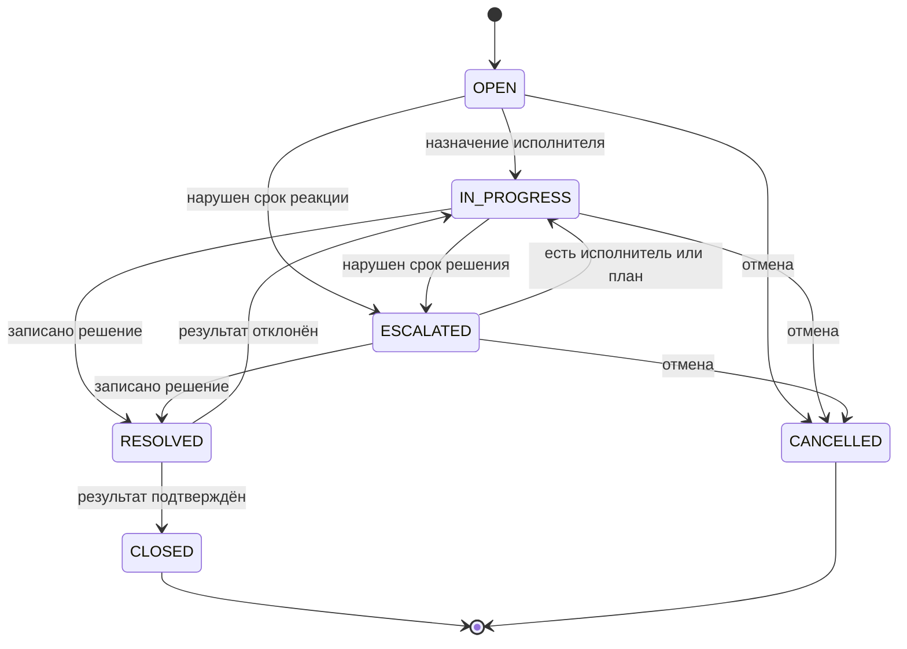

# Состояния Job

Job — инцидент. Имена состояний совпадают с заявкой практики 1.



`CLOSED` и `CANCELLED` конечные. Отмена сохраняет историю и уже записанную работу, срок SLA дальше не считается. При возврате `RESOLVED → IN_PROGRESS` прежний текст решения остаётся в истории.

## Запрещённые переходы

Любой переход вне диаграммы запрещён. Система отвечает `409`:

```json
{"error": {"code": "invalid_transition", "message": "Transition is not allowed", "details": {"from": "CLOSED", "to": "OPEN"}}}
```

Состояние, исполнитель, решение и история остаются прежними.

| Откуда | Куда | Ответ |
|---|---|---|
| CLOSED | любое состояние | 409 invalid_transition |
| CANCELLED | любое состояние | 409 invalid_transition |
| OPEN | RESOLVED | 409 invalid_transition |
| OPEN | CLOSED | 409 invalid_transition |
| IN_PROGRESS | OPEN | 409 invalid_transition |
| IN_PROGRESS | CLOSED | 409 invalid_transition |
| ESCALATED | OPEN | 409 invalid_transition |
| ESCALATED | CLOSED | 409 invalid_transition |
| RESOLVED | OPEN | 409 invalid_transition |
| RESOLVED | ESCALATED | 409 invalid_transition |
| RESOLVED | CANCELLED | 409 invalid_transition |
| RESOLVED | CLOSED | разрешён, если результат подтверждён |
| любое | то же самое состояние | 409 invalid_transition |

Переход в `RESOLVED` без текста решения — это не смена состояния, а `422 invalid_params` с `details.field = resolution`.
